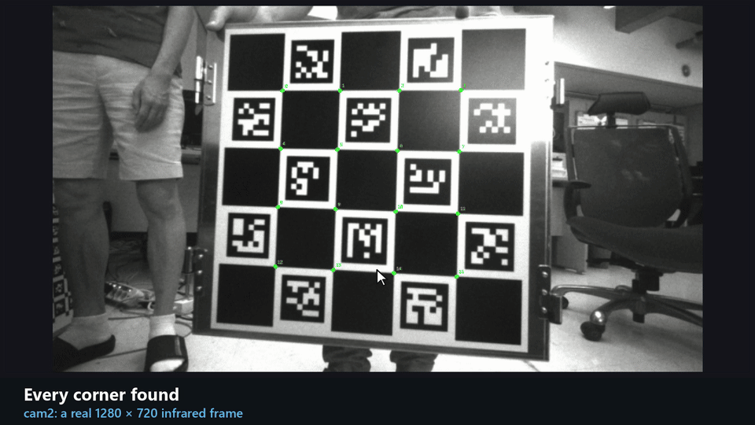

# Multi Object Camera Calibration Tool

Calibrate many cameras against many calibration targets in one solve, and see how far you can trust the result.

[](https://github.com/ibird-bot/multi-object-camera-calibration-tool/releases)
[](LICENSE)
[](pyproject.toml)



*Six RealSense infrared cameras from [MC-Calib](https://github.com/rameau-fr/MC-Calib)'s public dataset (Rameau et al., CVIU 2022).*

You declare cameras and boards, run detection, and every camera and board pose
is estimated in one bundle adjustment. The report then shows where the
calibration holds: per-pixel projection uncertainty, residual maps, parameter
correlations, coverage and held-out error. It runs as a desktop GUI or from
the command line, and both give the same numbers.

## Install

Python 3.12.

```bash
git clone https://github.com/ibird-bot/multi-object-camera-calibration-tool.git
cd multi-object-camera-calibration-tool
python -m venv .venv
.venv\Scripts\activate          # Linux / macOS: source .venv/bin/activate
pip install -e ".[gui]"
```

| Extra | Adds |
|---|---|
| none (`pip install -e .`) | Detection, solver (scipy), report and CLI. No Qt. |
| `gui` | Desktop app (PySide6, pyqtgraph, matplotlib) |
| `ceres` | Ceres backend: 17x faster than scipy on the four-camera example. Needs a compiled Ceres. |
| `dev` | pytest, ruff, mypy, coverage |

## Quick start

Check the install on synthetic data with known ground truth:

```bash
mlti-cal demo --cameras 3 --frames 20
```

Open the app:

```bash
mlti-cal-gui
```

Or calibrate from a config file, with cross-validation:

```bash
mlti-cal calibrate path/to/config.json --backend ceres --crossval -o Output/result
```

## Features

- Any number of cameras and calibration targets in one session. Cameras that
  never share a board are linked through the cameras between them.
- Charuco boards, checkerboards and dot grids, mixed in the same images. Marker
  ID collisions between boards are refused.
- Eight camera models with analytic Jacobians, from pinhole to Double Sphere.
- scipy and Ceres solver backends.
- A report built on uncertainty, not a single RMS number.
- Plug-ins for your own detector, calibration object (flat or 3D) and lens model.
- Export to JSON, YAML (OpenCV `FileStorage`) and PNG figures.

## Examples

### Six real cameras

`examples/real_6cam` calibrates three RealSense infrared stereo pairs
(1280 x 720) from MC-Calib's public `Seq02` sequence. The images are not
shipped: download `Real_Images` from the
[MC-Calib datasets](https://github.com/rameau-fr/MC-Calib#datasets), then

```bash
python examples/real_6cam/prepare.py PATH/TO/Seq02_Overlapping_multicamera
mlti-cal calibrate examples/real_6cam/config.json --backend ceres --crossval -o Output/real_6cam_result
```

Result on every 10th frame (552 images): 0.85 to 0.38 px RMS in 7 iterations,
held-out error 1.06x the training error. The three stereo baselines come out
at 49.6 to 49.7 mm; Intel lists 50 mm for the D435. The report warns that the
board never reached the image corners, which the uncertainty map below shows.

### Four rendered cameras with ground truth

`examples/rig_4cam` renders 120 images of a four-camera rig fanned over 100
degrees, with two Charuco boards, a dot grid and one wide Double Sphere lens.
Ground truth is saved next to the images.

```bash
python examples/rig_4cam/make_dataset.py     # about 3 minutes
mlti-cal calibrate examples/rig_4cam/config.json --backend ceres --crossval -o Output/rig_4cam
```

Result: 0.131 px RMS, every extrinsic within 0.5 mm and 0.03 degrees of the
truth, held-out error 0.99x the training error. The report also warns that the
wide lens's focal length and `xi` are correlated at +0.999. Their individual
values are off for that reason, while the lens still projects within 0.3 px of
the truth. The solve takes 2.7 s with Ceres and 46 s with scipy (i7-12700H).

## The report


*Camera 2 of the six-camera example. The corners are uncertain because no board was seen there.*

| Figure | Shows |
|---|---|
| Projection uncertainty | How far a point fixed to the boards may project wrong, per pixel, at a given range |
| Residual field | Error arrows per corner. A pattern means the model is missing something. |
| Residual map | RMS and mean error per sensor cell. The mean exposes systematic bias. |
| Correlations | Parameters the data cannot separate, including camera parameters against board poses |
| Coverage | Where corners were observed and how varied the board tilts were |
| Residual distribution | Histogram and Q-Q plot. Heavy tails mean outliers. |
| Error vs radius | Error growing toward the edge means the lens model is too simple |

Cells with no observations are drawn grey, not zero. Everything is also
written to `report.json`.

## Camera models

| Name | id | Params | Use for |
|---|---|---|---|
| OpenCV | `pinhole_radtan` | 9 | Normal and wide lenses. Start here. |
| OpenCV Fisheye | `fisheye_kb` | 8 | Kannala-Brandt fisheye, up to 180 degrees in total |
| Double Sphere | `double_sphere` | 6 | Fisheye, including beyond 180 degrees |
| Enhanced Unified | `eucm` | 6 | Fisheye and catadioptric, including beyond 180 degrees |
| Thin Prism | `thin_prism` | 16 | Rational radial, tangential and prism distortion |
| Matlab | `matlab` | 10 | OpenCV plus skew |
| FOV | `fov` | 5 | One distortion parameter, up to 180 degrees in total |
| Halcon Division | `halcon_division` | 5 | One parameter, closed-form inverse |

## Plug-ins

Bring your own detector, calibration object or lens without changing the
package. Each is one Python file in `~/.mlti_cal/plugins/`:

```python
def detect(image, settings):   # -> (N, 3) array of [target_id, x, y]
    ...

def project(params, points):   # -> (N, 2) pixels; Jacobians optional
    ...
```

An object is a text file with one `id, x, y, z` line per target, in metres.
Every plug-in result is validated, and a plug-in that breaks its contract is
reported and skipped. Test yours with `mlti-cal plugins check FILE`.

Templates are in [`examples/plugins/`](examples/plugins/), and
[`examples/custom_object`](examples/custom_object) uses all three together (a
3D marker cube, an ArUco detector and a custom lens, calibrated to within
0.34 mm of the truth).

## Validation

Compared with other calibration tools on public data:

| Compared with | Data | Result |
|---|---|---|
| [mrcal](https://mrcal.secretsauce.net/) 2.4.1 | 1 camera, 84 real images | Identical RMS (0.524893 px), projection uncertainty within 1.5% |
| mrcal and OpenCV | Real stereo pair | Identical RMS to mrcal; OpenCV intrinsics within 1.1 sigma |
| [Kalibr](https://github.com/ethz-asl/kalibr) (published) | TUM VI fisheye stereo, real | Rotation within 0.024 deg, baseline within 0.5 mm of 101 mm |
| [MC-Calib](https://github.com/rameau-fr/MC-Calib) | 6 real cameras, no ground truth | 0.3736 vs 0.3754 px on identical corners, poses within 0.022 deg |
| MC-Calib and ground truth | 5 rendered cameras | Poses within 1.3 mm and 0.033 deg; MC-Calib's own about twice as close |
| [BabelCalib](https://github.com/ylochman/babelcalib) benchmark | 8 real fisheye lenses, up to 250 deg | 0.25 px held-out with Double Sphere or EUCM, level with Kalibr. Kannala-Brandt and FOV fail past 90 deg off-axis. |

Method, limits and reproduction steps: [`docs/validation.md`](docs/validation.md).

## Documentation

- [Validation](docs/validation.md)
- [Plug-in contracts](docs/extending.md)
- [Writing a full detector](docs/writing-a-detector.md)
- [Changelog](CHANGELOG.md)

Coordinate conventions:

- Camera frame is OpenCV: +x right, +y down, +z forward.
- `T_a_b` maps points from frame `b` to frame `a`. `Camera.extrinsic` is
  `T_cam_rig`, board poses are `T_rig_board`.
- Poses are stored as `[tx, ty, tz, qx, qy, qz, qw]` (scalar last). The
  tangent is `[dt; phi]` with the retraction `t + dt`, `q (x) Exp(phi)`.
- The reference camera is fixed at identity. Scale is metric, from the boards.

## Development

```bash
pip install -e ".[dev]"
pytest                    # full suite, including slow end-to-end solves
pytest -m "not slow"      # what CI runs on every push
```

Versions follow [semantic versioning](https://semver.org/) from 1.0.0. A
breaking change to the config format, the CLI or the public Python API
(`mlti_cal.problem`, `mlti_cal.models`, `mlti_cal.solvers`, `mlti_cal.report`)
bumps the major version.

## License

MIT. See [LICENSE](LICENSE).
